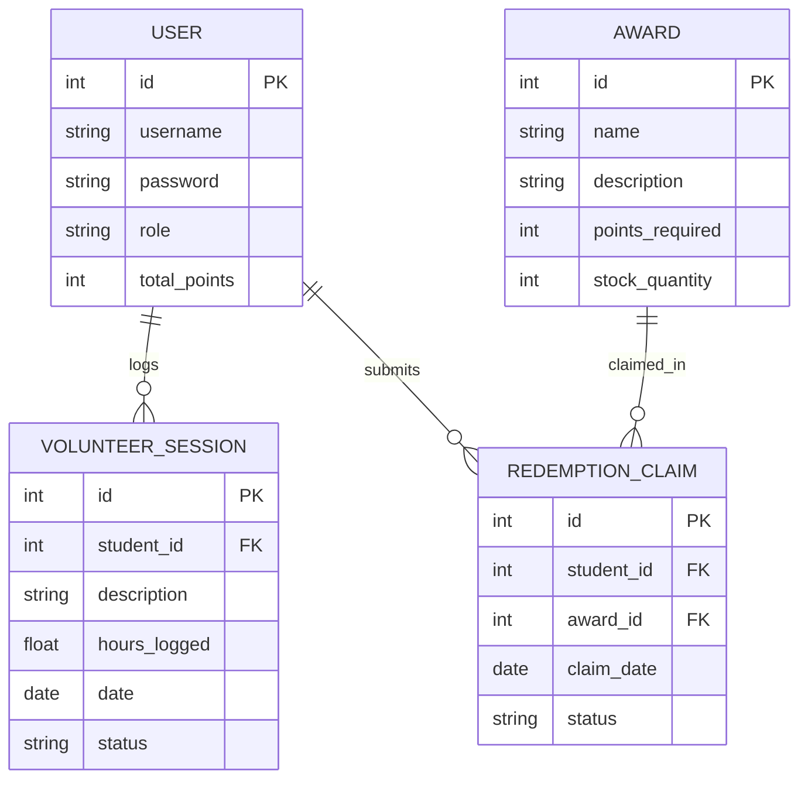

# COMP 3613 Assignment 1

Draft this file with the Guide. **Update it after every phase milestone** before you pause. The use-case diagram is a UML PNG at `docs/diagrams/use-case.png`, linked from this file as `diagrams/use-case.png` (path relative to `docs/report.md`). The model diagram is Mermaid. **Embed wireframe images** as `wireframes/<file>` (files live in `docs/wireframes/`).

Do not put your student ID in this file if you will commit it. The PDF cover adds your name and ID at export time.

## Assigned project

Student Awards

## Three workflows

### 1.

Log Volunteer Hours (Student)

### 2.

Approve Volunteer Hours (Admin)

### 3.

Redeem Award (Student)

## Use case diagram

Assumptions accepted in Phase 2: authentication is modeled as a shared use case, `Redeem Award` includes browsing available awards plus eligibility/points checking, `Approve Volunteer Hours` includes reviewing submitted hours, admins manage an award catalog that supports multiple redeemable prize/award options, and an optional `Insufficient Points Notice` use case extends `Redeem Award`.

## Model diagram

First draft. Update this section in Phase 5 when polish revises the model, and note what changed.

Phase 3 notes: `VolunteerSession.status` and `RedemptionClaim.status` represent lifecycle states. Points are added only when volunteer hours are approved, and award stock decreases at claim submission.

## Wireframes

Embed each student-crafted wireframe here (Phase 4). Paths are relative to this file:

### Log Volunteer Hours (Student)

<!-- student-build:wireframe-coverage
use_case: Log Volunteer Hours (Student)
image: docs/wireframes/main-screen.png
covered: yes
-->

### Approve Volunteer Hours (Admin)

<!-- student-build:wireframe-coverage
use_case: Approve Volunteer Hours (Admin)
image: docs/wireframes/admin-screen.png
covered: yes
-->

### Redeem Award (Student)

<!-- student-build:wireframe-coverage
use_case: Redeem Award (Student)
image: docs/wireframes/rewards-screen.png
covered: yes
-->

Phase 4 clarification accepted: after approval, the admin remains on the approvals list with a success toast, and the student sees updated points immediately on the main screen.

`python manage.py report` also embeds any PNG/JPG still missing from `docs/wireframes/`.

## Theming

- Color palette: monochrome base (white surfaces, light-gray borders, charcoal text) with a soft slate-blue accent for primary and active states.
- Typography: Inter/Roboto sans-serif stack.
- Tone: professional and utilitarian with reduced visual ornamentation.
- Logo/wordmark: text wordmark “Student Awards”.

Applied in code:
- `app/templates/base.html` now loads Inter/Roboto.
- `app/static/css/app.css` now uses monochrome + slate-blue design tokens and simplified utility styling.
- `app/templates/landing.html`, `app/templates/login.html`, and `app/templates/register.html` now use the “Student Awards” wordmark and updated copy.

## Implementation notes

One named workflow at a time. Include verify notes and polish / model revisions (Phase 5). Do not treat the first build as final.

### Workflow: Log Volunteer Hours (Student) + Approve Volunteer Hours (Admin)

- Added volunteer-hours domain model in `app/models/volunteer_session.py` with pending/approved lifecycle.
- Added points tracking field on users (`app/models/user.py` → `total_points`).
- Added repository and service layers:
  - `app/repositories/volunteer_session.py`
  - `app/services/volunteer_session_service.py`
  - `app/repositories/user.py` now includes `add_points(...)`.
- Wired thin routes:
  - `POST /app/volunteer-sessions` for student hour submission.
  - `POST /admin/volunteer-sessions/{session_id}/approve` for approval + point award.
- Wired templates to match wireframe flow:
  - `app/templates/app.html` now includes points card, log-hours form, and session history table.
  - `app/templates/admin.html` now includes pending sessions with approve actions.
- Authenticated shell branding updated to “Student Awards” in `app/templates/authenticated-base.html`.
- Polish/fix pass after student verification feedback:
  - Fixed admin approval failure by aligning the route call with the service signature (`approve_session(volunteer_session_id=...)`).
  - Refactored authenticated layout from sidebar shell to top navigation to match the wireframe direction.
  - Updated authenticated controls to muted slate-blue actions (primary buttons and nav active states) to align with the selected theme.

Verify notes (student run): admin polish confirmed — approve button affordance and admin navigation behavior now match expectations.

### Workflow: Redeem Award (Student)

- Added rewards domain model and persistence:
  - `app/models/award.py`
  - `app/models/redemption_claim.py`
  - `app/repositories/award.py`
  - `app/repositories/redemption_claim.py`
- Added rewards business logic in `app/services/reward_redemption_service.py`:
  - eligibility check for insufficient points and out-of-stock awards,
  - claim creation with initial status `submitted`,
  - user points deduction and stock decrement in one service operation.
- Wired thin student routes in `app/routers/user_home.py`:
  - `GET /app/rewards` for rewards catalogue + claim history,
  - `POST /app/rewards/{award_id}/redeem` for redemption submission.
- Added rewards UI in `app/templates/rewards.html`:
  - eligible/ineligible claim actions,
  - inline ineligibility reason display,
  - claim history table.
- Added discoverability from the student dashboard in `app/templates/app.html`:
  - “Open Rewards Catalogue” action from the points panel.
- Seeded demo awards through CLI init flow in `app/cli.py` so Workflow 3 can be exercised after `python manage.py init`.
- Accessibility polish pass on rewards UX:
  - Increased claim-action contrast by replacing low-contrast link-style actions with high-contrast button styling.
  - Added visible keyboard focus treatment consistency via global `:focus-visible` styling in `app/static/css/app.css`.
  - Improved readability of rewards metadata and claim-history status tags with clearer contrast and semantic status colors.
  - Added screen-reader context for claim actions and a claims-table caption for better assistive-tech clarity.
- Student dashboard polish pass:
  - Increased points-card readability with explicit points units and supporting microcopy.
  - Improved session-history table clarity using a descriptive table caption and consistent one-decimal hour formatting.
  - Switched pending-status badges to stronger-contrast neutral styling for better scannability.
  - Improved role UX by making authenticated navigation role-aware (admins see Admin Review, students see Student Home) and redirecting admins away from the student dashboard route.
  - Updated admin approval action styling to a green success button for clearer positive-action affordance.

Verify notes (student run) pending.

## Deployed app

Phase 6. Public Render URL (not localhost). Markers open this to mark the three workflows.

https://

## Logins

Every account a marker needs, including extra users you added. Starter accounts:

- bob / bobpass — regular user
- admin / adminpass — admin

## YouTube URL

## Session transcripts

Filled when the Guide builds the report: the agent writes each Guide chat to `docs/transcripts/<slug>.md` (Copilot Agent, Cursor, or OpenCode). `python manage.py report` packages them. Do not paste chats here during the build.

## Competency (student-judge)

Filled when the report is built. Guide runs student-judge, writes `docs/judge.md`, and export appends the scorecard here.

## Skill integrity

Filled by `python manage.py report`. Do not edit the course skills.
