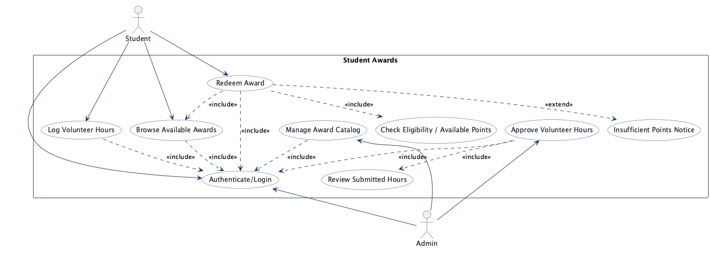
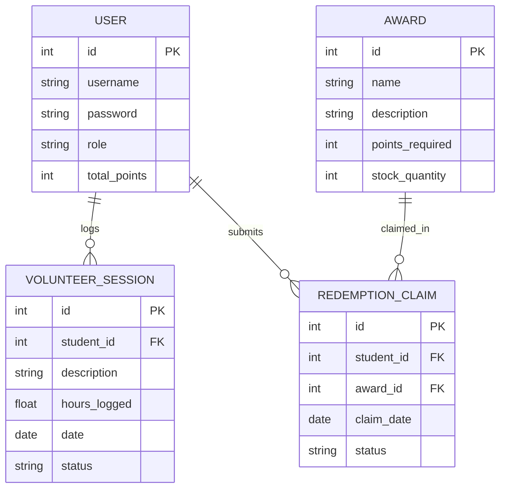
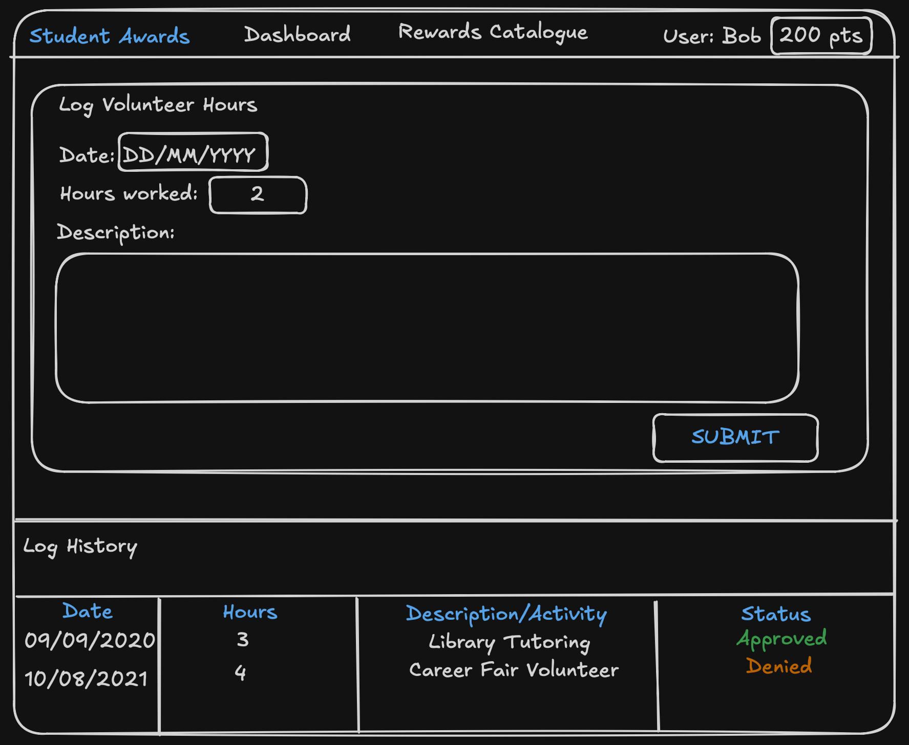
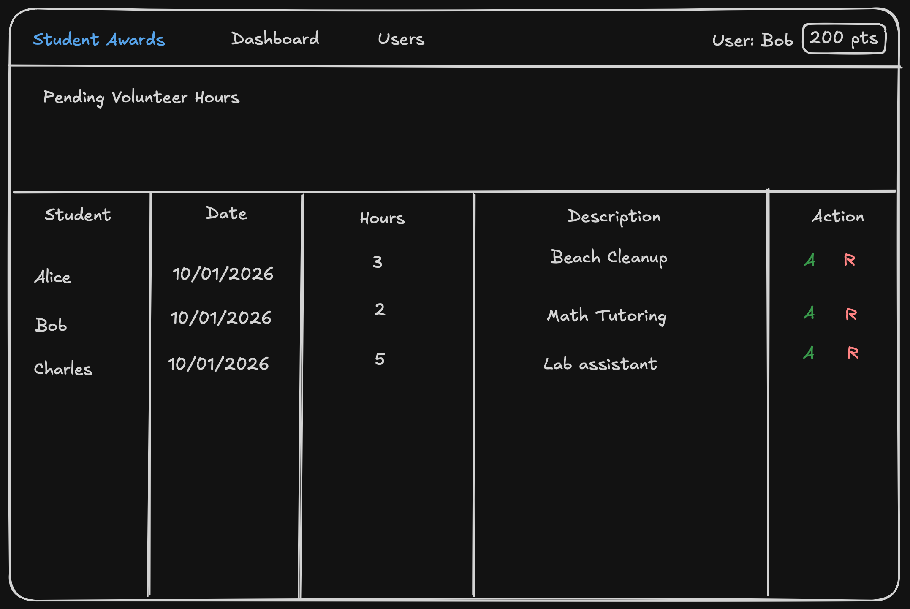
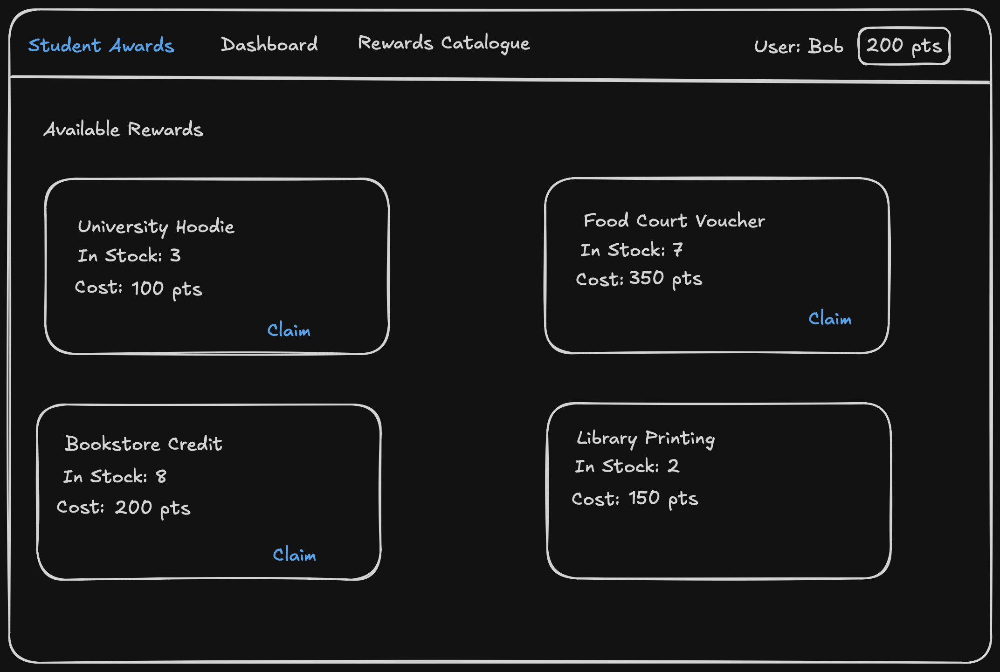

<!-- student-build:skill-integrity
status: pass
root: e84cd692d0b85eefe546385661958c27d07e8be6c5176a82012f68ccff5c8beb
expected_root: e84cd692d0b85eefe546385661958c27d07e8be6c5176a82012f68ccff5c8beb
mismatches: none
-->

# COMP 3613 Assignment 1

Draft this file with the Guide. **Update it after every phase milestone** before you pause. The use-case diagram is a UML PNG at `docs/diagrams/use-case.png`, linked from this file as `diagrams/use-case.png` (path relative to `docs/report.md`). The model diagram is Mermaid. **Embed wireframe images** as `wireframes/<file>` (files live in `docs/wireframes/`).

Do not put your student ID in this file if you will commit it. The PDF cover adds your name and ID at export time.

## Assigned project

Student Awards

## Three workflows

### 1.

Log Volunteer Hours (Student)

### 2.

Approve Volunteer Hours (Admin)

### 3.

Redeem Award (Student)

## Use case diagram

Assumptions accepted in Phase 2: authentication is modeled as a shared use case, `Redeem Award` includes browsing available awards plus eligibility/points checking, `Approve Volunteer Hours` includes reviewing submitted hours, admins manage an award catalog that supports multiple redeemable prize/award options, and an optional `Insufficient Points Notice` use case extends `Redeem Award`.

## Model diagram

First draft. Update this section in Phase 5 when polish revises the model, and note what changed.

Phase 3 notes: `VolunteerSession.status` and `RedemptionClaim.status` represent lifecycle states. Points are added only when volunteer hours are approved, and award stock decreases at claim submission.

## Wireframes

Embed each student-crafted wireframe here (Phase 4). Paths are relative to this file:

### Log Volunteer Hours (Student)

<!-- student-build:wireframe-coverage
use_case: Log Volunteer Hours (Student)
image: docs/wireframes/main-screen.png
covered: yes
-->

### Approve Volunteer Hours (Admin)

<!-- student-build:wireframe-coverage
use_case: Approve Volunteer Hours (Admin)
image: docs/wireframes/admin-screen.png
covered: yes
-->

### Redeem Award (Student)

<!-- student-build:wireframe-coverage
use_case: Redeem Award (Student)
image: docs/wireframes/rewards-screen.png
covered: yes
-->

Phase 4 clarification accepted: after approval, the admin remains on the approvals list with a success toast, and the student sees updated points immediately on the main screen.

`python manage.py report` also embeds any PNG/JPG still missing from `docs/wireframes/`.

## Theming

- Color palette: monochrome base (white surfaces, light-gray borders, charcoal text) with a soft slate-blue accent for primary and active states.
- Typography: Inter/Roboto sans-serif stack.
- Tone: professional and utilitarian with reduced visual ornamentation.
- Logo/wordmark: text wordmark “Student Awards”.

Applied in code:
- `app/templates/base.html` now loads Inter/Roboto.
- `app/static/css/app.css` now uses monochrome + slate-blue design tokens and simplified utility styling.
- `app/templates/landing.html`, `app/templates/login.html`, and `app/templates/register.html` now use the “Student Awards” wordmark and updated copy.

## Implementation notes

One named workflow at a time. Include verify notes and polish / model revisions (Phase 5). Do not treat the first build as final.

### Workflow: Log Volunteer Hours (Student) + Approve Volunteer Hours (Admin)

- Added volunteer-hours domain model in `app/models/volunteer_session.py` with pending/approved lifecycle.
- Added points tracking field on users (`app/models/user.py` → `total_points`).
- Added repository and service layers:
  - `app/repositories/volunteer_session.py`
  - `app/services/volunteer_session_service.py`
  - `app/repositories/user.py` now includes `add_points(...)`.
- Wired thin routes:
  - `POST /app/volunteer-sessions` for student hour submission.
  - `POST /admin/volunteer-sessions/{session_id}/approve` for approval + point award.
- Wired templates to match wireframe flow:
  - `app/templates/app.html` now includes points card, log-hours form, and session history table.
  - `app/templates/admin.html` now includes pending sessions with approve actions.
- Authenticated shell branding updated to “Student Awards” in `app/templates/authenticated-base.html`.
- Polish/fix pass after student verification feedback:
  - Fixed admin approval failure by aligning the route call with the service signature (`approve_session(volunteer_session_id=...)`).
  - Refactored authenticated layout from sidebar shell to top navigation to match the wireframe direction.
  - Updated authenticated controls to muted slate-blue actions (primary buttons and nav active states) to align with the selected theme.

Verify notes (student run): admin polish confirmed — approve button affordance and admin navigation behavior now match expectations.

### Workflow: Redeem Award (Student)

- Added rewards domain model and persistence:
  - `app/models/award.py`
  - `app/models/redemption_claim.py`
  - `app/repositories/award.py`
  - `app/repositories/redemption_claim.py`
- Added rewards business logic in `app/services/reward_redemption_service.py`:
  - eligibility check for insufficient points and out-of-stock awards,
  - claim creation with initial status `submitted`,
  - user points deduction and stock decrement in one service operation.
- Wired thin student routes in `app/routers/user_home.py`:
  - `GET /app/rewards` for rewards catalogue + claim history,
  - `POST /app/rewards/{award_id}/redeem` for redemption submission.
- Added rewards UI in `app/templates/rewards.html`:
  - eligible/ineligible claim actions,
  - inline ineligibility reason display,
  - claim history table.
- Added discoverability from the student dashboard in `app/templates/app.html`:
  - “Open Rewards Catalogue” action from the points panel.
- Seeded demo awards through CLI init flow in `app/cli.py` so Workflow 3 can be exercised after `python manage.py init`.
- Accessibility polish pass on rewards UX:
  - Increased claim-action contrast by replacing low-contrast link-style actions with high-contrast button styling.
  - Added visible keyboard focus treatment consistency via global `:focus-visible` styling in `app/static/css/app.css`.
  - Improved readability of rewards metadata and claim-history status tags with clearer contrast and semantic status colors.
  - Added screen-reader context for claim actions and a claims-table caption for better assistive-tech clarity.
- Student dashboard polish pass:
  - Increased points-card readability with explicit points units and supporting microcopy.
  - Improved session-history table clarity using a descriptive table caption and consistent one-decimal hour formatting.
  - Switched pending-status badges to stronger-contrast neutral styling for better scannability.
  - Improved role UX by making authenticated navigation role-aware (admins see Admin Review, students see Student Home) and redirecting admins away from the student dashboard route.
  - Updated admin approval action styling to a green success button for clearer positive-action affordance.

Verify notes (student run) pending.

## Deployed app

Phase 6. Public Render URL (not localhost). Markers open this to mark the three workflows.

[https://faststarter-465m.onrender.com](https://faststarter-465m.onrender.com)

## Logins

Every account a marker needs, including extra users you added. Starter accounts:

- bob / bobpass — regular user
- admin / adminpass — admin

## YouTube URL 

https://youtu.be/L9TUMekhEeo

## Session transcripts

Filled when the Guide builds the report: the agent writes chat markdown into `docs/transcripts/`; `python manage.py report` packages them.

Guide packaged **4** chat(s) in `docs/transcripts/` (and `docs/transcripts.zip`).

Index: [docs/transcripts/INDEX.md](transcripts/INDEX.md)

- [`phase-1-start-chat`](transcripts/phase-1-start-chat.md)
- [`phase-2-use-case-chat`](transcripts/phase-2-use-case-chat.md)
- [`phase-3-model-chat`](transcripts/phase-3-model-chat.md)
- [`phase-4-5-build-polish-and-export`](transcripts/phase-4-5-build-polish-and-export.md)

## Competency (student-judge)

Filled by Guide from the student-judge run when this report was built.

**Judged at:** 2026-10-12T02:38:38Z  
**Evidence pass:** re-read native chats + current [report.md](./report.md) + [docs/diagrams/](./diagrams/) + [docs/wireframes/](./wireframes/) + [docs/transcripts/](./transcripts/) (prior judge ignored)

**Student / session:** COMP 3613 assignment session(s) in this workspace  
**Artifact:** Native Copilot sessions + [docs/transcripts/](./transcripts/) markdown dump + [report.md](./report.md)  
**Phases in evidence:** 1–6 (COMP 3613; Phase 5 includes polish, Phase 6 deploy)

### Totals
| | Count / value |
|--|--|
| Metrics on rubric | 12 (M1–M12) |
| N/A (excluded) | 0 |
| Metrics scored | 12 |
| Scoreable max | 48 |
| Awarded total | 37 / 48 |
| **Overall (avg of scored)** | **3.08 / 4** |
| Impression mark | 15 / 20 |

## Scorecard

| ID | Metric | Score / 4 | In avg | Evidence |
|----|--------|----------:|:------:|----------|
| M1 | Phase discipline | 3 | yes | Phase progression is present (Phase 4 → Phase 5 polish → Phase 6 deploy). Student explicitly requested polish before export (“**Yes please move on to phase 5 polishing**”). |
| M2 | Problem framing | 3 | yes | Clear project/workflow framing captured in [report.md](./report.md) (`Student Awards`; 3 `Feature (user)` workflows). |
| M3 | Decision ownership | 3 | yes | Student-directed milestones and corrections are evident in turns (“**embed the wireframes in the report**”, “**start phase 5**”, “**Yes please move on to phase 5 polishing**”). |
| M4 | Artefact-before-code | 3 | yes | Wireframes are embedded with coverage blocks in [report.md](./report.md) before implementation sections; implementation notes map to ERD/wireframes. |
| M5 | Verification habit | 3 | yes | Verification/polish loop is present (student feedback drove UI/nav fixes); report includes verification notes for admin polish, though one line still states rewards verify pending. |
| M6 | Assignment fit | 3 | yes | FastStarter-style layered implementation is documented (`models/repositories/services/thin routes`) and architecture break checks found no inline SQL in current router files. |
| M7 | Slice explanation | 2 | yes | Student’s own explanatory depth is limited in retrievable transcripts (mostly short directives). Quote evidence is mostly terse steering, e.g. “**1**” and “**Yes please move on to phase 5 polishing**”, with little direct layer reasoning in student text. |
| M8 | Prompt quality | 3 | yes | Prompts are concise and phase-aligned (“start phase 5”, “embed the wireframes…”, export request). |
| M9 | Response to pushback | 3 | yes | Student accepted iterative refinement and asked to continue polishing rather than stopping at first pass. |
| M10 | Integrity | 4 | yes | No laundering markers or skill tampering found. [report.md](./report.md) includes `student-build:skill-integrity` with “**status: pass**” and matching roots. |
| M11 | Provenance continuity | 3 | yes | Work stays aligned with declared project/workflows/artefacts in [report.md](./report.md); transcripts and code changes remain on that path. |
| M12 | Sincerity trajectory | 4 | yes | No sincerity-spiral blocks found in available evidence; no abandonment or escalation pattern present. |

## Strengths
- Strong phase continuity through build → polish → deploy request sequence.
- Good artefact discipline in [report.md](./report.md): use-case image, ERD, wireframe embeds, implementation and polish notes.
- Clear polish engagement (student requested/accepted iterative UI and workflow refinement rather than ending at first build).
- Integrity signals are clean (`skill-integrity` pass, no suspicious transcript patterns).

## Gaps (priority order)
1. Student-owned technical explanation depth is light in retrievable chat evidence (especially layer rationale in their own words), which holds M7 below high-band.
2. Verification evidence is good but not uniformly explicit for every workflow in the report text (one “verify pending” note remains), limiting M5 from 4.

## Phase gate status
| Phase | Status | Note |
|-------|--------|------|
| 1 | met | Project and three workflows are recorded in [report.md](./report.md). |
| 2 | met | Use-case diagram and assumptions are present in [report.md](./report.md) and [use-case.png](./diagrams/use-case.png). |
| 3 | met | ERD and relationship notes are present in [report.md](./report.md). |
| 4 | met | Wireframes are embedded with coverage blocks in [report.md](./report.md). |
| 5 | met | Theme/build/polish are all documented; student explicitly requested additional polish. |
| 6 | met | Public URL and marker logins are present in [report.md](./report.md). |

## Recommended next practice
- In your next project, add one short “why this layer” note per workflow (model/service/route) in your own words right after implementation to raise M7 from solid to high.

## Integrity note
- Clean.

## Provenance flags
- None.

## Sincerity log summary
- Blocks found: 0 | max round: 0 | min/mean/final confidence: N/A | trend: N/A | cleared: yes (no suspicion invoked)

## Skips
- Skips: 0/3 used (no explicit skip usage found in available evidence).

## Skill integrity

Course skills are hashed at export and compared to `.agents/skills.lock.json`. Do not edit `.agents/skills/`, `.cursor/skills/`, or `AGENTS.md`.

- Status: **pass**
- Root: `e84cd692d0b85eefe546385661958c27d07e8be6c5176a82012f68ccff5c8beb`
- none
